# Fellow Notes for Mac

**Handwritten notes, typed notes, whiteboards and PDFs — together in one library on your Mac.**

Fellow Notes is a digital notebook for studying, lectures, meetings and everyday note-taking. Write and
draw on lined, grid or dotted paper, type formatted notes, mark up PDFs, plan on an endless
whiteboard, and find everything again with search and tags. Your notes stay on your Mac, work offline,
save automatically and can be backed up to iCloud Drive.

**[⬇ Download the latest version](https://github.com/KaranvirKals/FellowNotes-releases/releases/latest)** ·
[All versions](https://github.com/KaranvirKals/FellowNotes-releases/releases) ·
Free · Mac with Apple silicon (M1 or later), macOS 13 Ventura or later ·
**Signed and approved by Apple** — it opens like any other app (version 1.0.0 needed [one extra step](#opening-it-the-first-time))

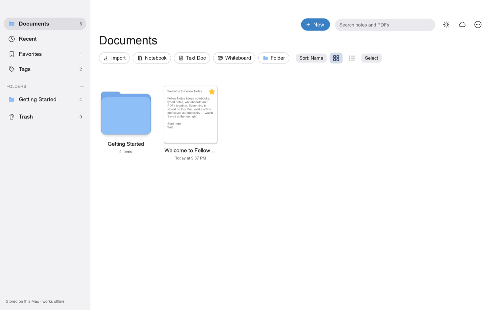

### New in 1.4.0
- **Templates for everything** — 53 free text templates (lecture notes, SOAP note, meeting notes, planners…), 28 new notebook layouts and 26 more whiteboards
- **Import PowerPoint and Keynote slides** — each slide becomes a page you can write on
- **Side by side** by dragging a tab, and **Search All Documents** (⇧⌘F) from any notebook
- **Simpler recordings** (record, play and delete from the microphone), a **sidebar you can hide** and **folders that open and close**
- **Safer and more private**: recordings survive a crash, Spotlight is off unless you turn it on, and many fixes from a full review

### New in 1.3.1
- **Make the toolbar yours** — drag buttons where you want them, or off the toolbar; every button is there to start
- **Settings in one place** (⌘,) and a tidier menu
- A toolbar that **fits any window**, **Present** from the toolbar, flashcard badges you can turn off, and many fixes

### New in 1.3
- **Find an Action (⌘K)** — type a few letters of anything Fellow Notes can do, or a notebook's name
- **Dictate** (⌥⌘D) — speak and the words are typed where the cursor is
- **Notebooks in Spotlight** — find your notes with ⌘Space
- **Favorite pens**, **Go to Page** (⌘G), **scribble to erase** and **View Only**
- **Flashcards out and in** — export for Anki, import decks from Anki or a spreadsheet
- A formatting bar that shows where you are, smoother zooming, and a full check-up: safer backups and syncing, cleaner icon toolbars

### New in 1.2.1
- **Import from iPhone or iPad works** — photos land on your page, scans are added as pages
- Cleaner **icon toolbars** for text boxes, selections, pictures, shapes, sticky notes and tables
- **Deleting a text box is one click** — the × at its corner, the trash can, or Esc then ⌫

### New in 1.2
- **Import from iPhone or iPad** — take a photo or scan a page straight onto your notes
- **Elements** — save drawings, diagrams and pictures and reuse them on any page
- **Searchable recordings** — what was said is turned into text on your Mac and found by search
- A cleaner **Flashcards** screen with **settings**, **Practice**, **Undo**, picture cards, review stats and a Dock badge
- **Today's Note** (⌥⌘T), **Version History** for each notebook, and a **pen while presenting**
- **Rotate and crop pictures**, **straight pen lines** with ⇧, and a Backups window that fits the screen

### New in 1.1
- **Handwriting is searchable** — and **Convert to Text** turns handwriting into typed text
- **Lasso** selection, and rough shapes that **snap** into neat lines, boxes and circles
- **Record audio** with your notes — select anything you wrote to hear that moment
- **Flashcards** with spaced review, made from your tagged lines
- **Present** page by page with a laser pointer, on a projector or in a video call
- **Lock** private notebooks with Touch ID
- **Custom tags**, **side by side**, **Print**, **Focus mode** and **Night Paper**
- A cloud button that turns **green, orange or red** with your backup

---

## Contents
- [Write and draw](#write-and-draw)
- [Typed notes](#typed-notes)
- [PDFs](#pdfs)
- [Whiteboards](#whiteboards)
- [Notebooks, paper and covers](#notebooks-paper-and-covers)
- [Organize and find](#organize-and-find)
- [Study, record and present](#study-record-and-present)
- [Private notebooks](#private-notebooks)
- [AI study assistant](#ai-study-assistant-optional)
- [Export and share](#export-and-share)
- [Themes and style](#themes-and-style)
- [Backups and sync](#backups-and-sync)
- [Automatic updates](#automatic-updates)
- [Install](#install)
- [Opening it the first time](#opening-it-the-first-time)
- [Privacy](#privacy)
- [Questions](#questions)

---

## Write and draw
Pick a tool from the toolbar (or press its letter) and write on the page with a mouse, trackpad or
drawing tablet.

- **Pen** in three thicknesses and any color, and a see-through **highlighter**
- **Eraser** that removes whole strokes or just the part you rub out
- **Shapes**: lines, arrows, boxes and circles
- **Text boxes** with fonts, sizes, bold/italic and alignment
- **Sticky notes** in six colors
- **Tables** — Tab moves between cells
- **Pictures** — drag a photo or screenshot onto the page
- **Select** anything to move, resize, recolor or delete it, with alignment guides that line things
  up with each other and the page — drag a free **lasso** around handwriting to pick just that
- **Neat shapes**: draw a rough circle, box or line and hold the pen still for a moment
- **Convert to Text**: select handwriting and turn it into a typed text box (⌘Z brings it back)
- **Tags** on any line: To Do (with a checkbox), Important, Question, Follow Up, Board Review and
  Definition, plus **your own tags** with their own name, color and symbol — collected in one place in
  the library
- Unlimited **undo and redo**, and a **Deleted** list to bring back removed pages

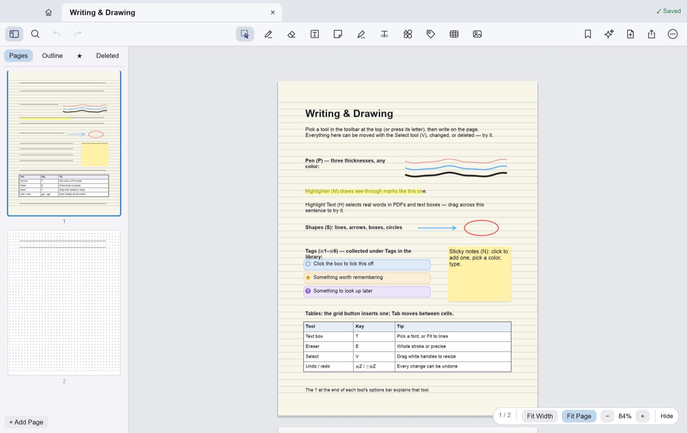
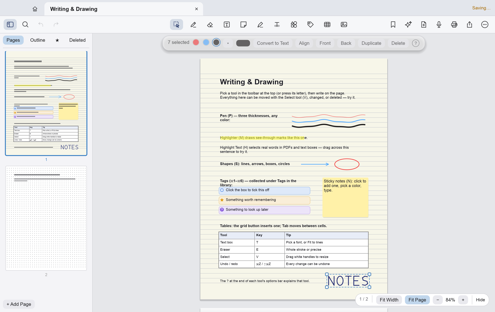

## Typed notes
Text documents for typed notes, with simple formatting as you type: `#` for headings, **bold** (⌘B)
and *italic* (⌘I), numbered and bulleted lists, `- [ ]` checklists that show up as To Dos, and links
(⌘K) to websites or to other notes in your library.

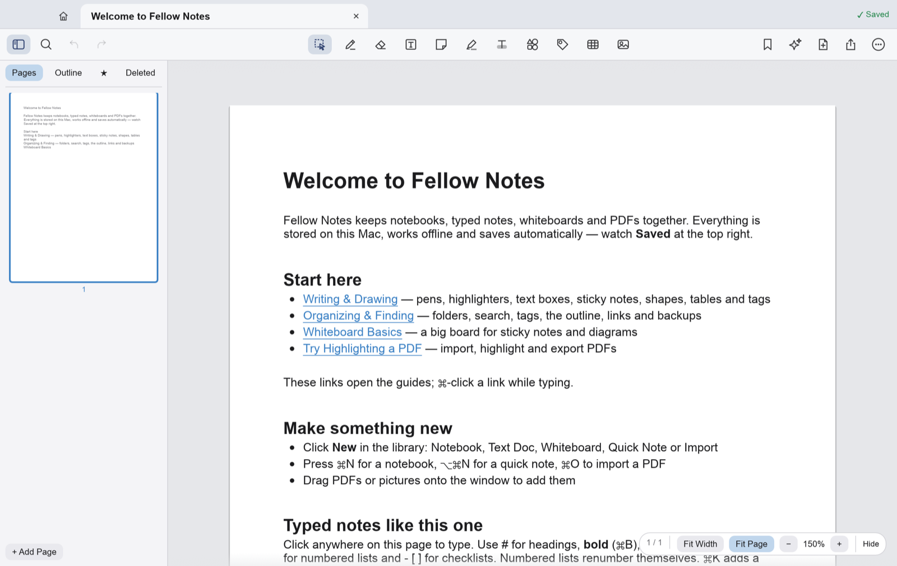

## PDFs
Import PDFs (⌘O, or drag them onto the window) and work on them like paper:

- **Highlight the real text** (press H and drag across a sentence, or double-click a word)
- Write in the margins, add text boxes and sticky notes
- **Search inside PDFs** — even scanned PDFs, which are read automatically so their words are
  searchable
- Add blank or lined pages between PDF pages, reorder and delete pages
- The original PDF is never changed; your markup is stored alongside it

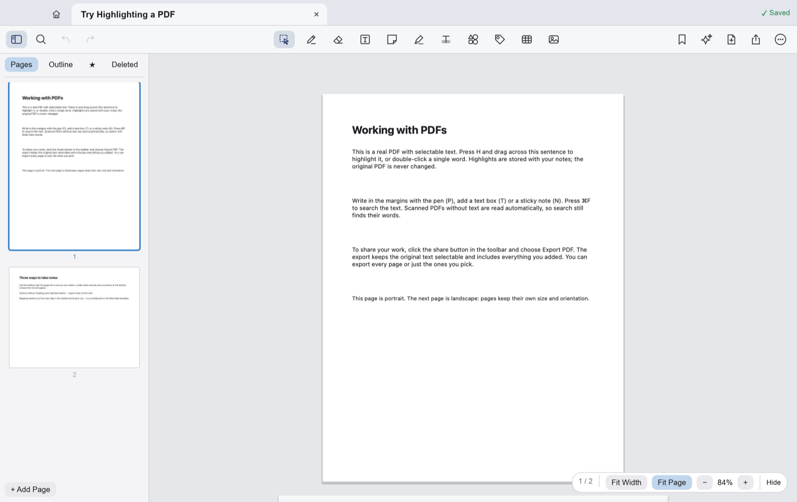

## Whiteboards
A large dotted board for sticky notes, diagrams and brainstorming. Zoom in and out freely (pinch, or
⌘+ / ⌘−) and start from templates: project planning (to do, doing, done), SWOT analysis, two- and
three-circle Venn diagrams, concept map, KWL chart, study board, daily standup, retrospective,
journal club and more.

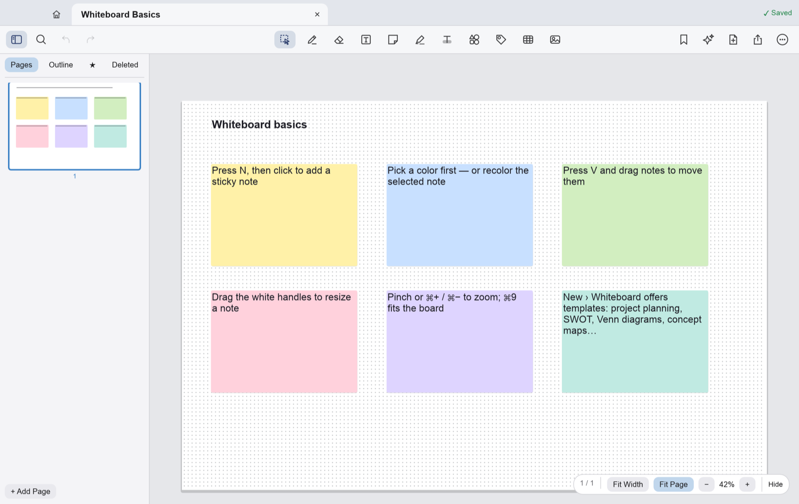

## Notebooks, paper and covers
When you make a notebook, choose its size (US Letter or A4, portrait or landscape), paper color,
cover and paper template:

- **About 60 paper templates** — blank, ruled (college, narrow, wide, with margins), dotted, squared,
  graph, engineering, isometric, hexagon, Cornell notes and legal pad; one-, two- and three-column
  layouts; daily, weekly and monthly planners, year at a glance and study schedule; to-do list, habit
  tracker, meeting notes, action items, project plan, Kanban board, timeline, goal setting, mind map,
  brain dump, priority matrix, monthly budget and 30-day challenge; lecture notes, flashcards, reading
  log and lab notebook; music paper and guitar tablature; handwriting practice and calligraphy;
  storyboards; and a few medical worksheets
- **Make Your Own** paper: lines, dots, grid, isometric or hexagon, with your own spacing, color,
  margin, columns and title line
- Different pages in the same notebook can use different paper

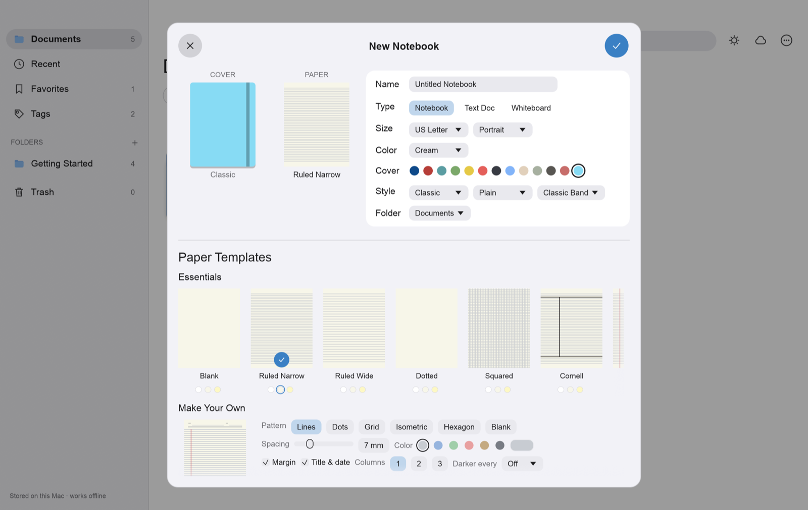

Notebook **covers** look like real notebooks — classic, leather journal, composition, spiral, field
notes, linen, planner and sketchbook — and every part can be changed: color, material (leather, linen,
kraft paper, polka dots, stripes, grid, marble, gradient or your own photo), binding, title label,
ribbon bookmark, elastic band, metal corners and a sticker.

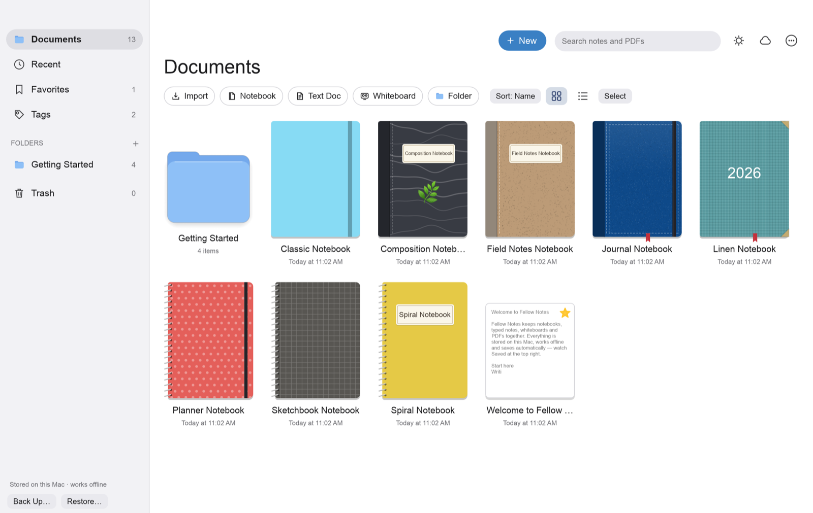
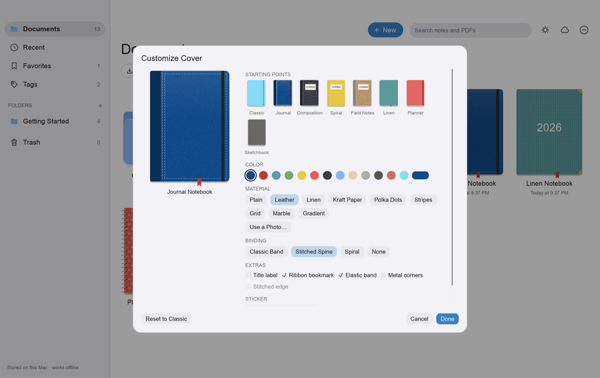

## Organize and find
- **Folders** (and folders inside folders), each with its own color, symbol or emoji (780 to choose
  from) or picture
- **Favorites** and **Recent** for what you use most
- **Search** across every notebook, typed note and PDF — including your **handwriting** and scanned
  PDFs
- **Side by side**: open two documents next to each other (View → Side by Side With)
- **Tags** bring every To Do, Important line, Question and your own tags from all your notes into
  one list; tick To Dos off right there; make, rename or delete your own tags
- **Outline** and bookmarks to jump around long notebooks, and links between notes
- Sort by name, date modified or date created; grid or list view; select several items to move,
  export or delete them at once
- **Trash** keeps deleted notes until you empty it

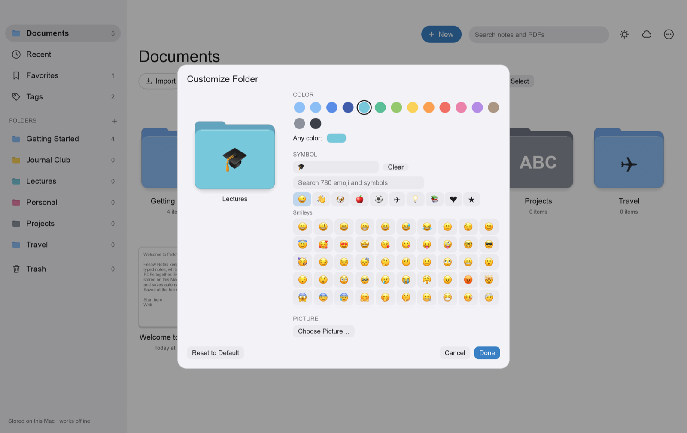
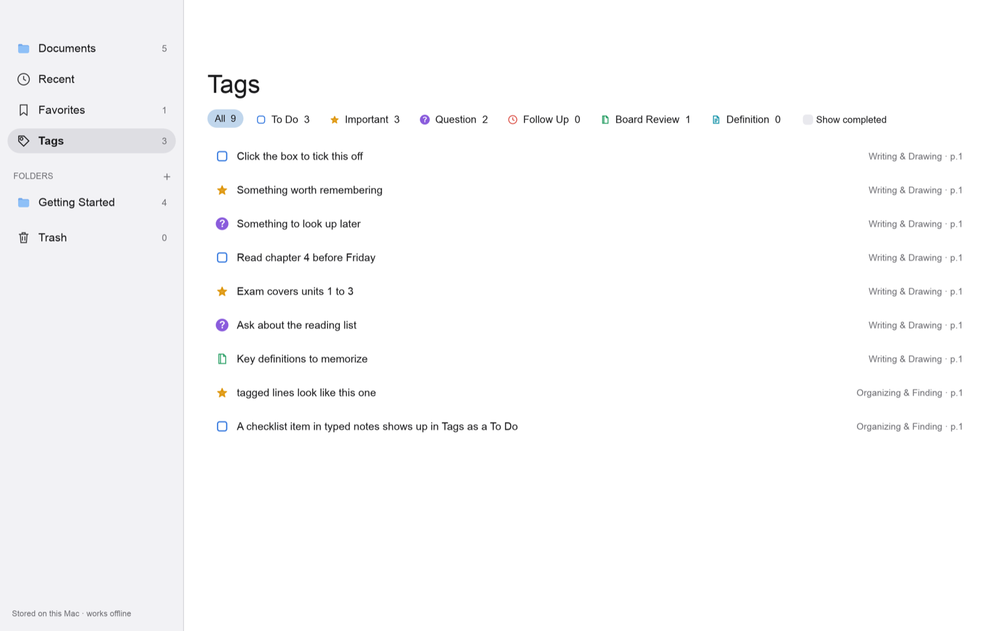
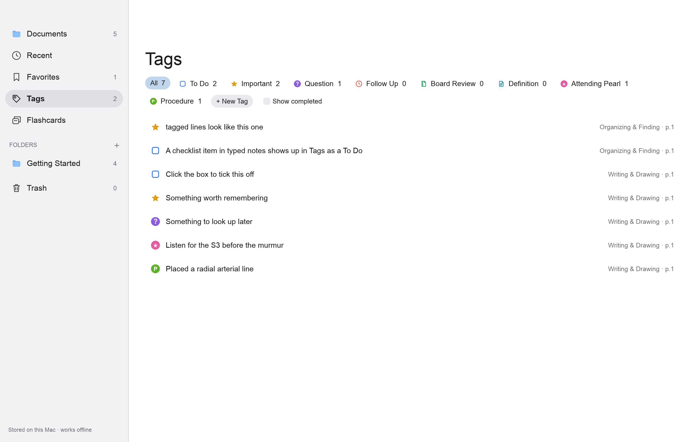
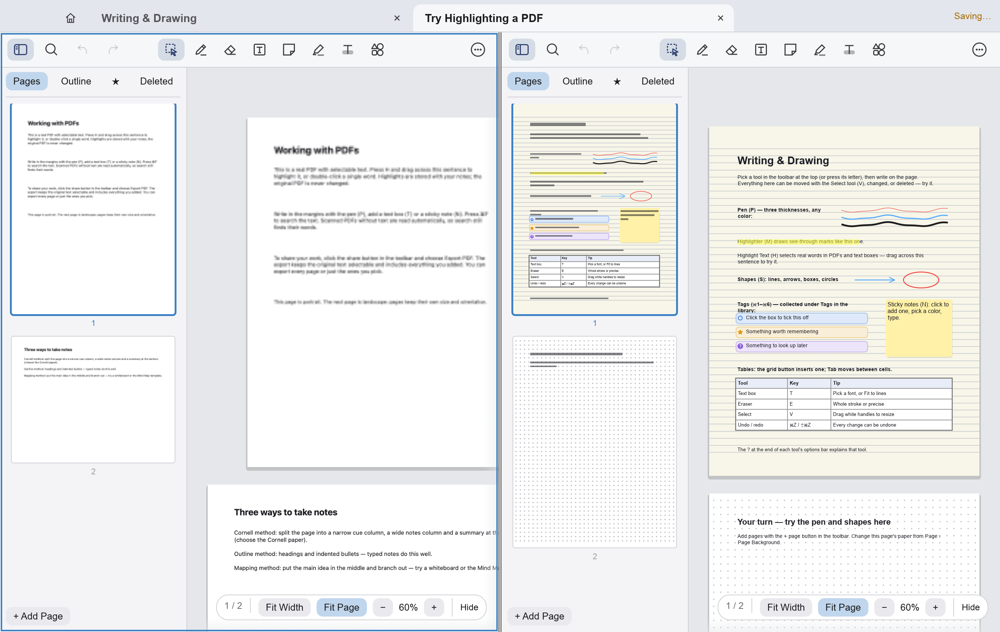

## Study, record and present
- **Record audio** while you write (the microphone in the toolbar). Everything you write is linked to
  the moment it was written: select it later to hear what was being said. During playback, what was
  written later shows faintly until the recording reaches it.
- **Flashcards**: lines you tag Board Review or Definition become cards by themselves — write
  "term — meaning" for a front and a back — or choose **Make Flashcard** on any text box or highlight.
  Review shows each card, then **Again / Hard / Good / Easy** decide when it comes back.
- **Present** (⌥⌘P): your pages full screen, one at a time, with a laser pointer that fades. The
  **Audience Window** shows only the page on a projector, second display or video call, while your
  screen shows the next page and a timer.
- **Focus mode** (⌃⌘F) hides everything but the page and a small tool bar; **Night Paper** makes pages
  dark with light ink for late-night reading.

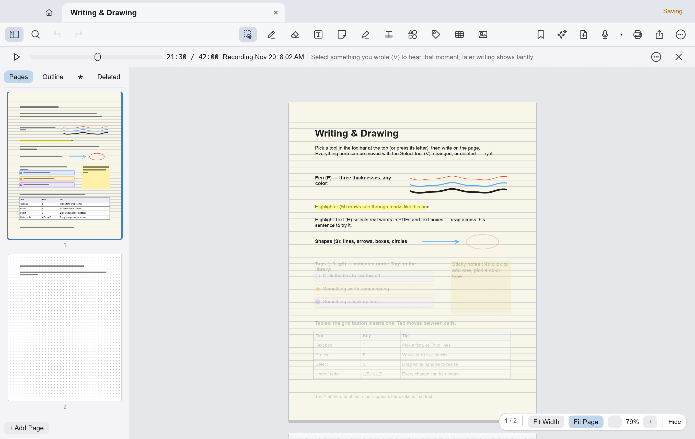
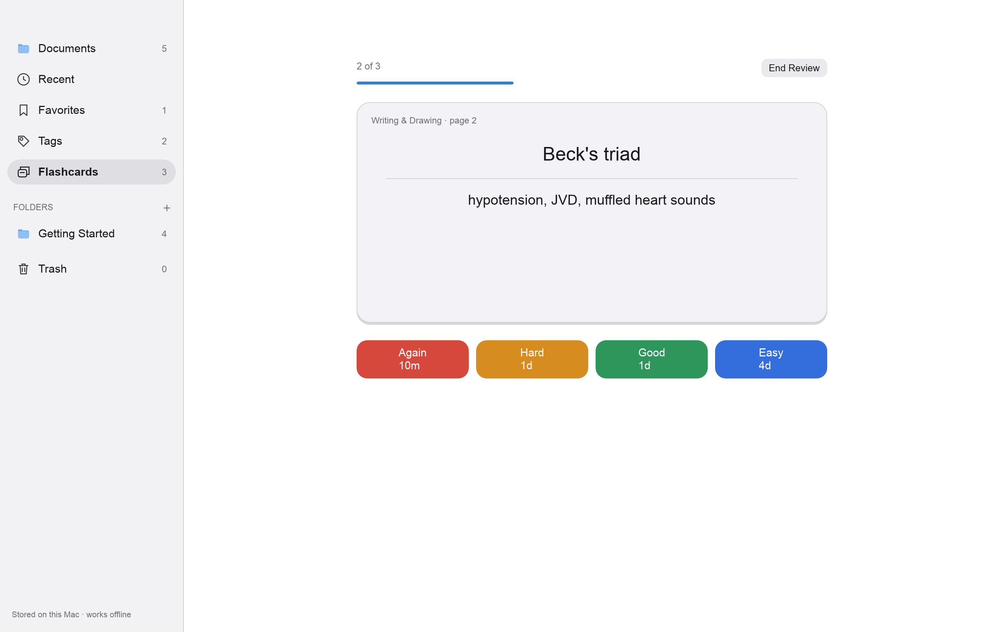
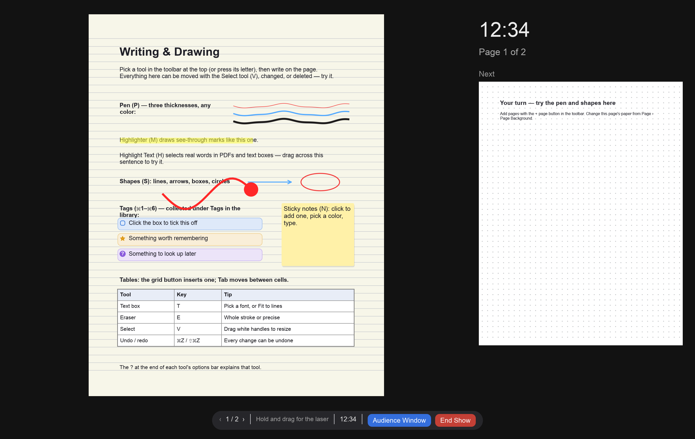
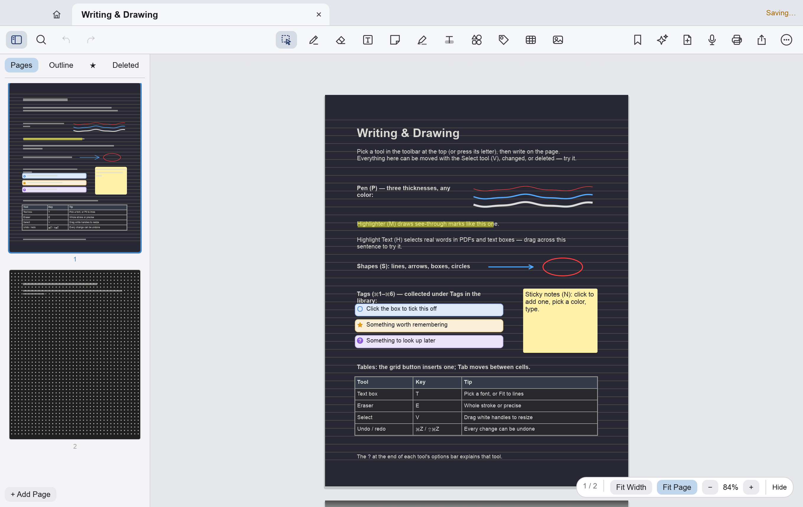

## Private notebooks
**Lock** a notebook from its ••• menu: opening it then asks for Touch ID or your Mac's password. A locked
notebook shows a lock instead of its pages, is found by its title only, and keeps its tags and flashcards
out of sight until you open it. (Locking hides it inside Fellow Notes; the files themselves aren't
encrypted.)

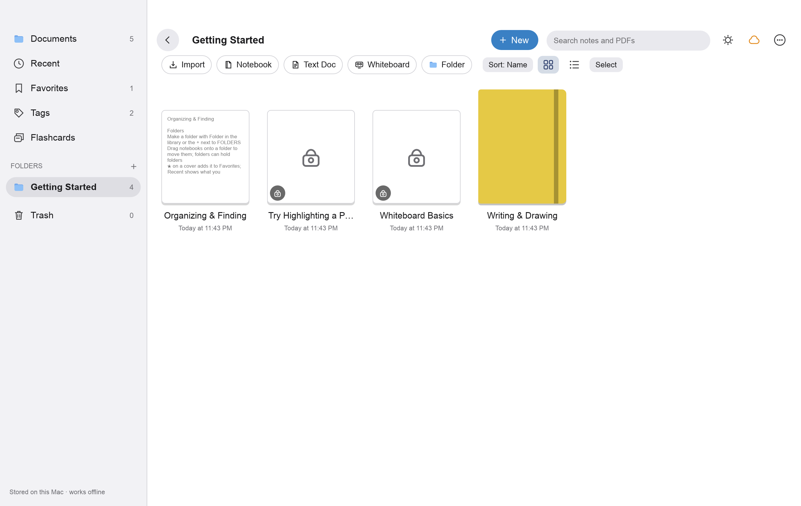

## AI study assistant (optional)
Ask an assistant about the page or the whole notebook: **summarize**, **key points**, **quiz me**,
**explain my highlights**, **explain the figures** or **what's missing?** — or ask anything. In *Edit
note* mode you tell it how to change the page, and every change can be undone.

Use the AI service you already have — the setup window walks you through it:
**Claude** (with your Claude subscription through Claude Code, or an API key), **ChatGPT** (with your
ChatGPT plan through Codex, or an OpenAI API key), **Google Gemini**, **Perplexity**, or a model that
runs entirely on your Mac with **Ollama**. Nothing is sent anywhere unless you ask the assistant
something.

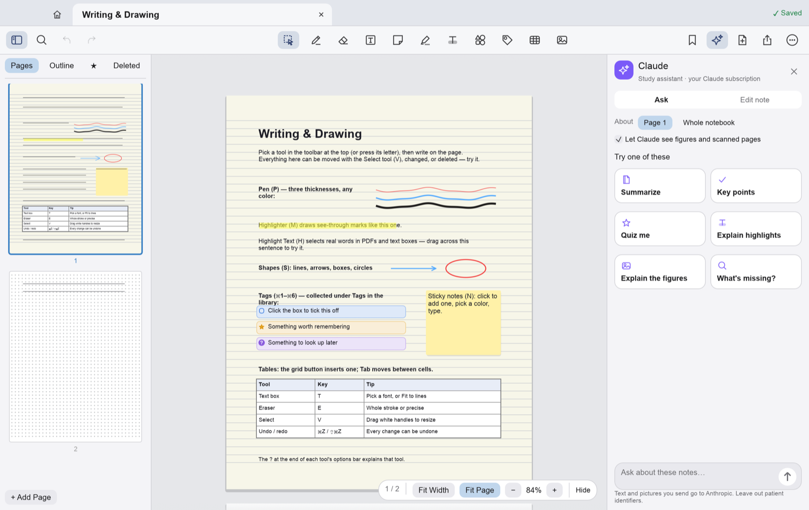

## Export and share
Export a notebook, a typed note or a PDF — all pages, the current page, selected pages or a range —
as **PDF** (original PDF text stays selectable), **Word (.docx)**, **Markdown**, **plain text**, or
**pictures (PNG or JPEG)**. Several items can be exported at once. **Print** (⌘P, or the printer in the
toolbar) prints everything you added.

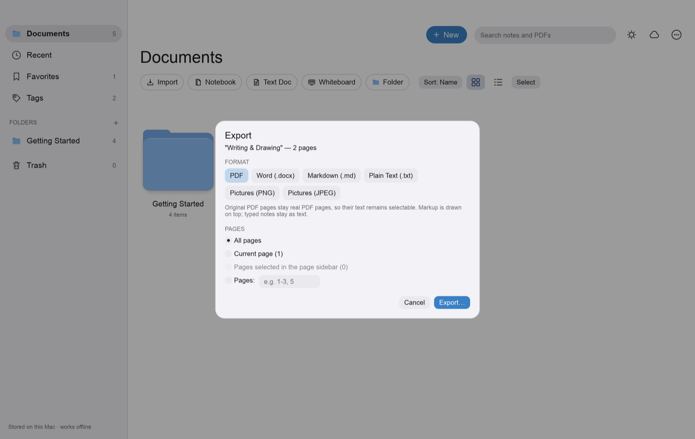

## Themes and style
Light, dark or matching your Mac; nine color themes (Classic, Ocean, Forest, Sunset, Lavender, Rose,
Sepia, Midnight and Graphite); any accent color; square, rounded or extra-round corners; compact,
comfortable or roomy spacing; and four text sizes.

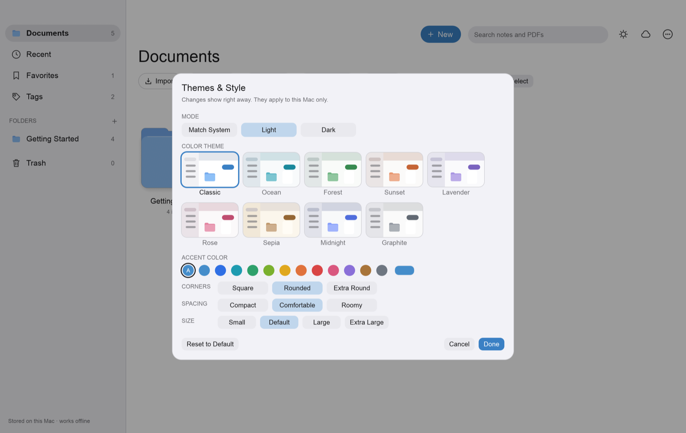
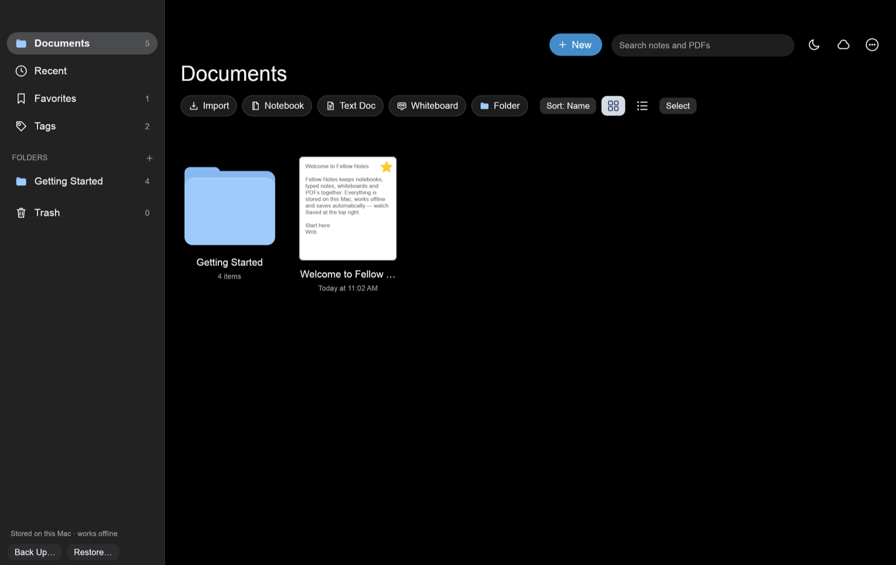

## Backups and sync
- **Automatic backups** of your whole library (notebooks, PDFs, typed notes, markup, folders, covers
  and custom paper) after you make changes and when you quit — to **iCloud Drive** or any folder you
  choose. Each backup is checked after it's written, and nothing is ever lost converting it back.
- Choose how many backups to keep (or how many days); older automatic backups remove themselves.
- **Restore** any backup, with a safety copy of what you had first.
- The **cloud button** shows how it's going: **green** when everything is backed up, **orange** while
  backing up or with changes waiting, **red** if a backup failed.
- **Sync between Macs** through iCloud Drive: when you open Fellow Notes it brings in a newer version
  saved on another Mac; if both changed, it asks which to keep.
- A **sync panel** shows what's happening: when you close the app it saves, makes a backup and
  uploads it to iCloud before closing; when you open it, it checks for and brings in the newest
  version.

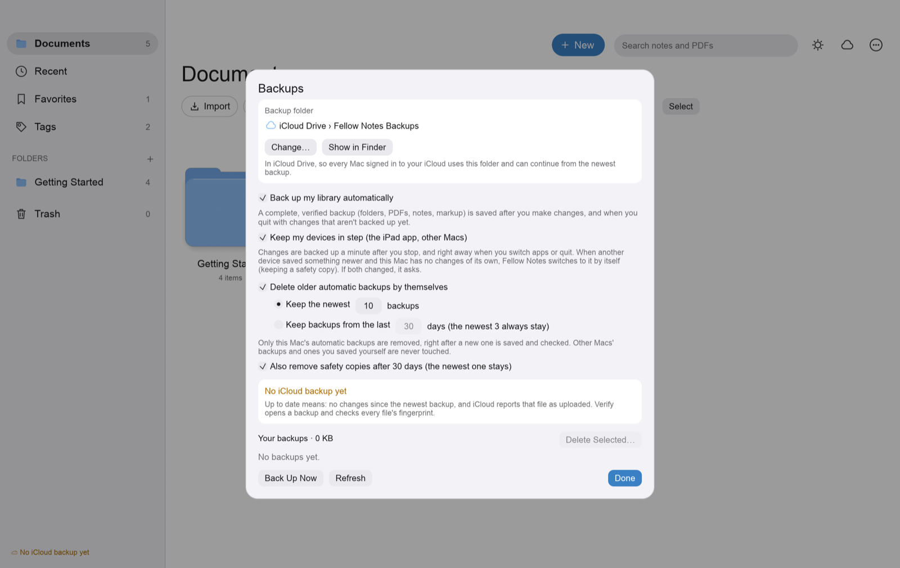
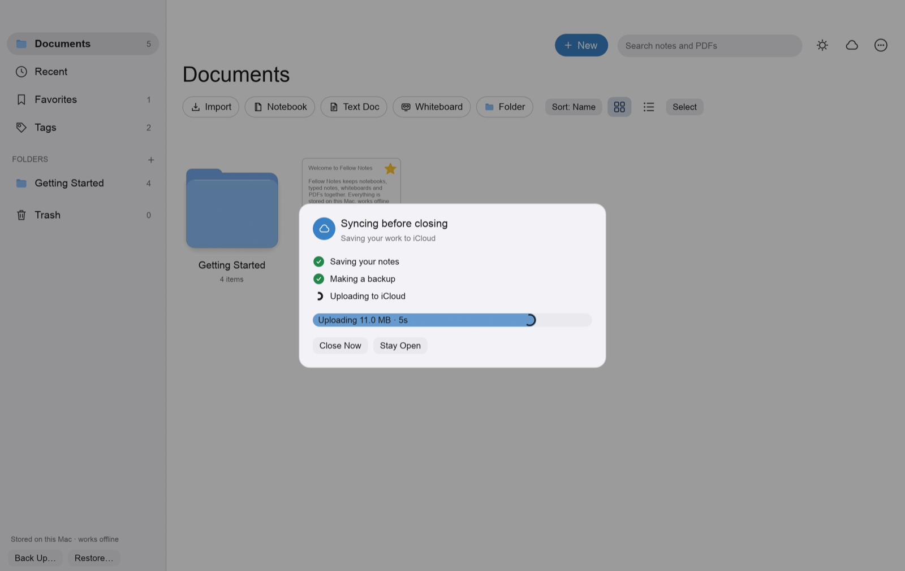

## Automatic updates
You only download Fellow Notes once. When a new version comes out, it tells you what's new and offers:

- **Update Now** — backs up your notes, installs the new version and reopens (about a minute)
- **Later** — installs by itself the next time you close the app
- **Skip This Version**

Every update is checked before it installs: it must be signed by the publisher, match its published
checksum, and pass macOS's own code-signature check. The version before is kept, just in case.
Settings are under **••• → Check for Updates**.

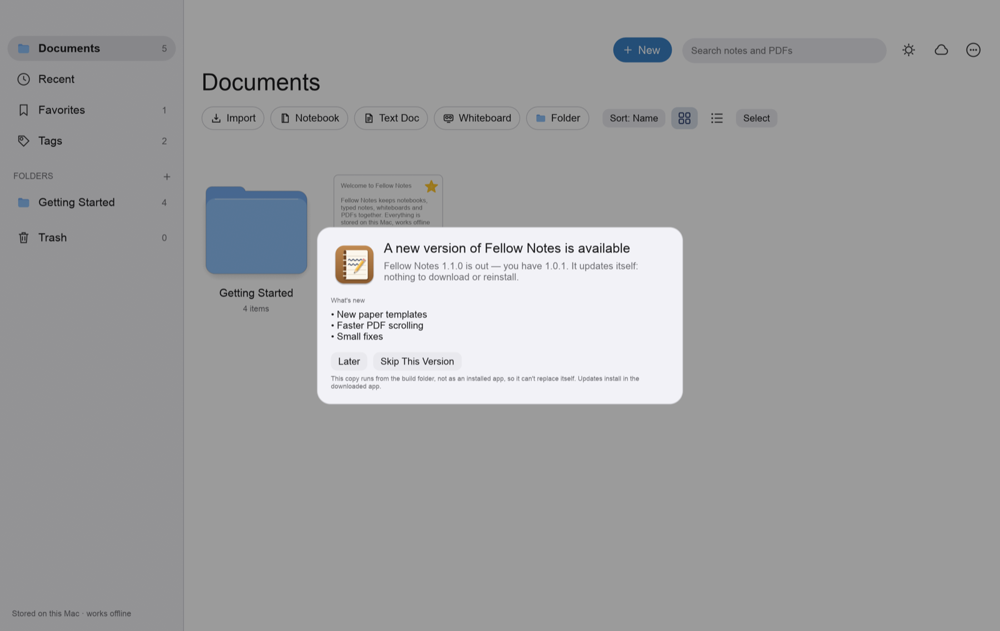

---

## Install
1. **[Download the latest version](https://github.com/KaranvirKals/FellowNotes-releases/releases/latest)** —
   under *Assets*, click `FellowNotes-<version>.dmg`.
2. Open the downloaded file and drag **Fellow Notes** onto **Applications**.
3. Open Fellow Notes from your Applications folder. From version 1.0.1 it's signed by its developer and
   approved by Apple, so it opens like any other app (macOS may ask once whether to open an app from the
   internet — click **Open**).

**Requirements:** a Mac with Apple silicon (M1, M2, M3, M4 or later) and macOS 13 Ventura or later.
Intel Macs aren't supported yet.

## Opening it the first time
**Version 1.0.1 and later don't need this** — they're signed and approved by Apple. Only the first version
(1.0.0) shows the message below; updating to the newest version (••• → Check for Updates) fixes it.

With version 1.0.0, the first time you open Fellow Notes, macOS shows this:

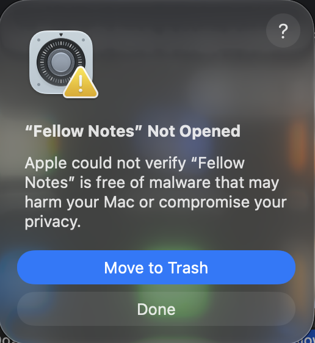

This appears for any app downloaded from outside the App Store that hasn't been through Apple's paid
review ("notarization") — it doesn't mean anything was found wrong with it. **Don't click Move to
Trash.** Use either way below; you only need to do it once.

### Way 1: System Settings (no typing)
1. Click **Done** in the message.
2. Open **System Settings** (Apple menu  → System Settings…) and click **Privacy & Security** in the
   sidebar.
3. Scroll down to the **Security** section. You'll see *"Fellow Notes" was blocked to protect your
   Mac.* Click **Open Anyway** next to it.
   (This button shows for about an hour after the message — if it isn't there, open Fellow Notes
   again, click **Done**, and come back.)
4. Click **Open Anyway** again in the box that appears, and enter your Mac password or use Touch ID.
5. Fellow Notes opens. From now on it opens normally, like any other app.

### Way 2: Terminal (one line)
1. Open **Terminal** (press ⌘Space, type *Terminal*, press Return).
2. Paste this line and press Return:
   ```
   xattr -dr com.apple.quarantine "/Applications/Fellow Notes.app"
   ```
3. Open Fellow Notes from Applications. It opens normally from now on.

This removes the "downloaded from the internet" mark that macOS puts on the app — the same thing
Open Anyway does.

> Right-clicking the app and choosing **Open** no longer gets past this message on recent versions of
> macOS; use one of the ways above.

## Privacy
- Your notes are stored on your Mac (in `~/Library/Application Support/Fellow Notes`). There's no
  account, no sign-up and no tracking.
- Backups go only where you choose (iCloud Drive or a folder on your Mac).
- The app contacts the internet only to check for updates (this page), and to reach the AI service
  you set up when you ask it something.

## Questions
**Is it free?** Yes.

**macOS says "Fellow Notes" Not Opened / Apple could not verify it is free of malware.** That only
happens with the first version, 1.0.0. Download the newest version (it's signed and approved by Apple),
or follow [Opening it the first time](#opening-it-the-first-time).

**Do I need to download each new version?** No. Fellow Notes offers each new version itself and
installs it for you.

**Can I go back to an earlier version?** Every version is on the
[Releases page](https://github.com/KaranvirKals/FellowNotes-releases/releases). Download the one you
want and drag it into Applications. Your notes aren't affected.

**Where are my notes, and how do I move them to a new Mac?** Turn on backups to iCloud Drive (cloud
button in the library). On the new Mac, install Fellow Notes and sign in to the same iCloud account —
it offers to continue from the newest backup. You can also use **Restore From Backup** with a backup
file.

**Does it work offline?** Yes — everything except the AI assistant and update checks works without
the internet.

**Does it work with an iPad or Apple Pencil?** Not yet; this release is for the Mac.

---
<sub>Fellow Notes for Mac. This page holds only the downloads; each release lists what changed.</sub>
